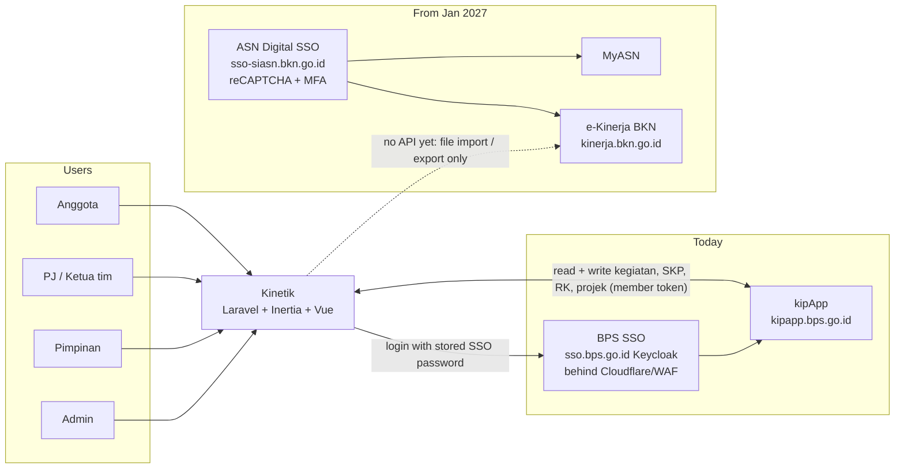
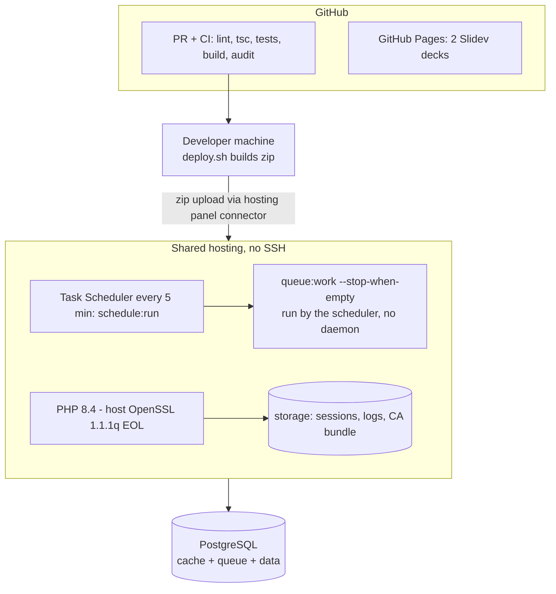
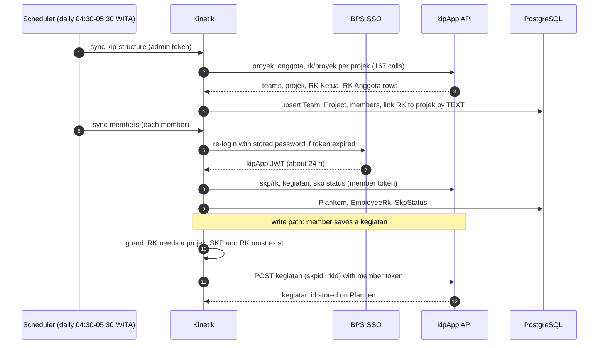
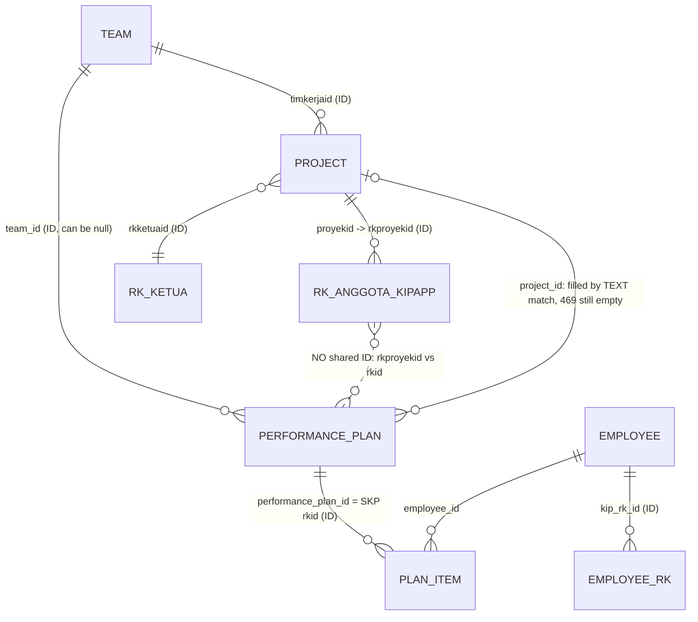
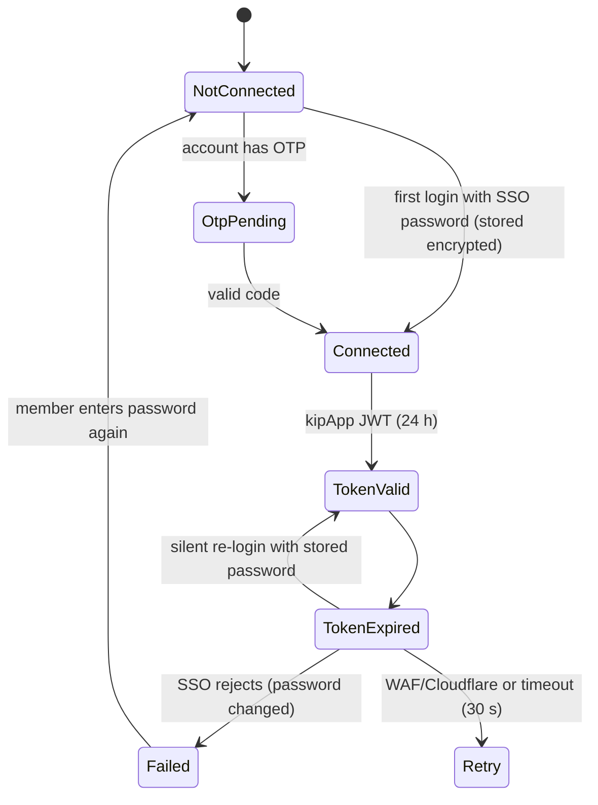
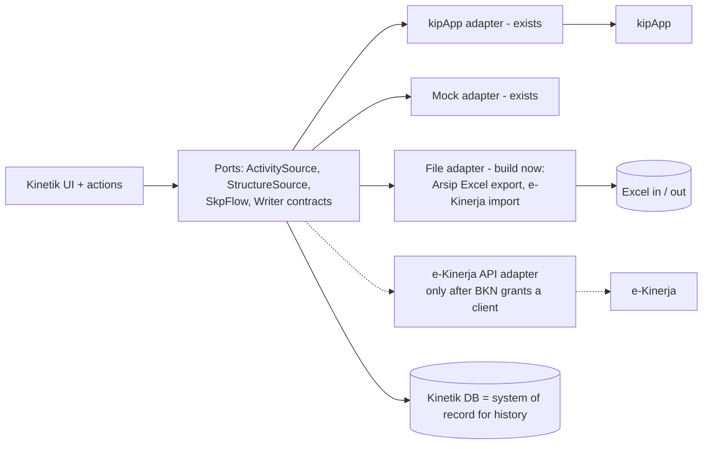

# Kinetik: system architecture, data flows and the e-Kinerja migration plan (2026-11-02)

Evidence for the external systems: [[myasn-ekinerja-integration-feasibility]] (public pages and shipped JS only). Everything about Kinetik is read from this repository and from prod on 2026-11-02.

## 1. System context

## 2. Infrastructure

Constraints that shape every design: no SSH and no long-running worker (jobs run at most every 5 minutes), jobs after a response use `dispatchAfterResponse`, cache and queue live in PostgreSQL, sessions in files, the outbound TLS bundle is shipped with the app, local and CI use SQLite so SQL must stay portable.

## 3. Data flow: kipApp to Kinetik (read) and back (write)

## 4. Data model and where the relationships break

Finding: kipApp has IDs for team, projek and RK Ketua, but the SKP-side RK row (`skp/rk`) carries only `rkid`, `timkerjaid` and the leader RK as text. The projek-side row (`rk/proyek`) carries `rkproyekid`. No field joins the two, so Kinetik joins on normalized RK text. Result on prod: 1,006 RK without a projek, 537 linked by text, 469 not in any projek (RK tambahan or ambiguous).

## 5. Authentication and token lifecycle

Lessons already paid for: WAF blocks `curl/` User-Agents; Cloudflare challenges Laravel's default JSON headers; login steps needed 30 s. After January the same flow cannot be copied to ASN Digital (reCAPTCHA + MFA on every login).

## 6. Target architecture: provider adapters

The contracts already exist (`KipActivitySource`, `KipStructureSource`, `StructureFlow`, mock and API implementations bound in `KinetikServiceProvider`). Migration means adding adapters, not rewriting features.

## 7. Risks

| Risk | Impact | Mitigation |
|---|---|---|
| kipApp retired in Jan 2027 | Push and sync stop | Arsip export now, file adapter, keep Kinetik as record |
| No BKN API access | No automatic sync to e-Kinerja | Ask BKN for an OIDC client; meanwhile file bridge |
| ASN Digital login has reCAPTCHA and MFA | Cannot store passwords | Do not store; identity via OIDC if a client is granted |
| RK to projek joined by text | 469 RK without projek, mismatches | Integritas data page, push guard, manual pick |
| Shared hosting limits | No daemon, 5 min jobs, EOL OpenSSL | Keep jobs short; plan move to a VPS if BKN integration needs long jobs |
| SSO fragility (WAF/Cloudflare, timeouts) | Login and sync failures | Browser-style headers, 30 s timeouts, logs with user |

## 8. Action plan to January 2027

| When | Action | Owner | Done when |
|---|---|---|---|
| Nov wk1 | Arsip kipApp export live for every member (done in PR) | Dev | Every member can download history |
| Nov wk1 | Letter/ticket to BKN (support-siasn) asking for an OIDC client and API partner access for Kinetik | Admin + Kepala | Written answer received |
| Nov wk2 | Fix 426 RK without projek via Integritas data and sync | Admin | rk_no_project below 50 |
| Nov wk2 | Capture e-Kinerja data model from the Buku Panduan (support-siasn) and from one member's own screens | Dev + 1 pilot member | Field mapping RHK/kegiatan harian written |
| Nov wk3 | File adapter: export in the e-Kinerja column order; import from e-Kinerja reports | Dev | Round trip on pilot data |
| Dec wk1 | Pilot: 3 members move one team's SKP 2027 into e-Kinerja, Kinetik runs recap from imports | Pilot team | Weekly recap works without kipApp |
| Dec wk2 | Freeze kipApp write features (feature flags) when BKN confirms the cut-off | Admin | Flags off |
| Dec wk3 | Decision: e-Kinerja API adapter (if client granted) or stay on file bridge; hosting move decision | Admin + Kepala | ADR written |
| Jan | Go live on e-Kinerja for SKP 2027; Kinetik = recap, paraphrase, monitoring, FRA, angka kredit, archive | All | First weekly recap on new data |
