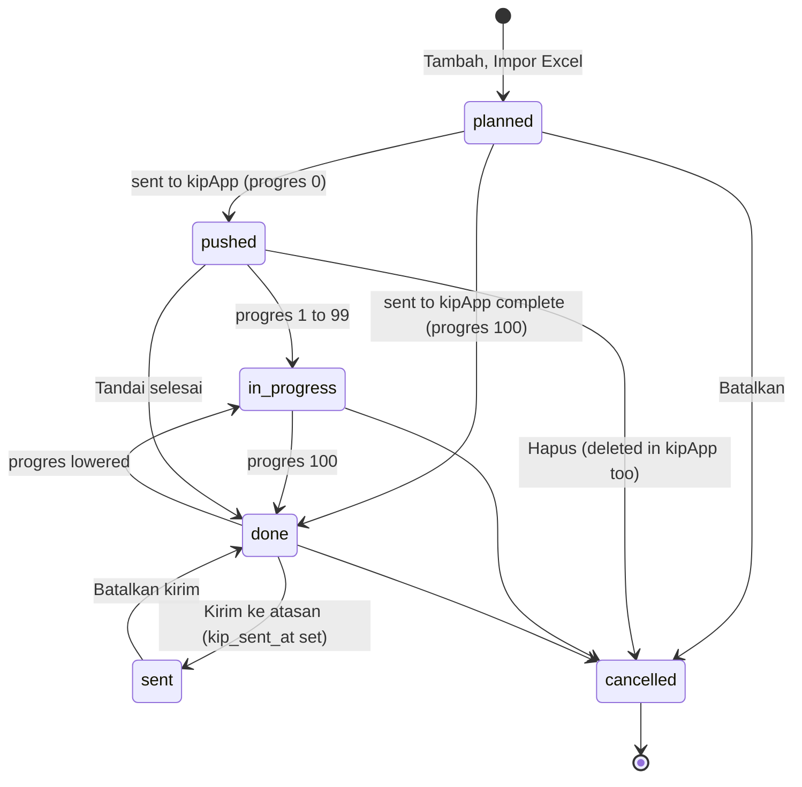

# State machines in Kinetik

This page lists every lifecycle in the app, where its rules live, and what is still implicit. Read it before you change a status.

## 1. Kegiatan (plan item)

Stored facts on `plan_items`: `status`, `kip_external_id`, `kip_sent_at`, `progress`.
Rules in code: `App\Kinetik\PlanStatus` (stored status), `App\Kinetik\PlanStage` (what a person sees), `App\Services\Kinetik\PlanItemAccess` (what is allowed).
Frontend twin: `resources/js/composables/usePlanStage.ts` (label, color, next action). Rows sent to the browser carry `stage`.

Rules:
- A kegiatan in kipApp takes its status from the kipApp progres. Use `PlanStatus::fromKipProgress()`. Do not write the mapping again.
- `cancelled` is final, and nothing returns to `planned`. `PlanItem` writes a log warning when a save breaks this rule. It does not block the save.
- `sent` is not a status value. It is `kip_sent_at` not null. Use `$plan->stage()` when you need the whole picture.
- A kegiatan goes to kipApp only when complete: progres 100, uraian of 10 characters, bukti dukung, and capaian when a target is set. See `PlanItem::missingForKip()`.
- A kegiatan folded into another one is `cancelled` with `merged_into_id` set.

Realisasi and kipApp (changed 2026-11-11):
- `SaveRealisasiAction` is the one way to save capaian, progres, uraian, bukti dukung and permasalahan.
- It writes Kinetik first. Then it updates kipApp when the kegiatan is there and not sent to the atasan.
- A kegiatan that the save made complete goes to kipApp at once (`sent`). The hourly run stays as a safety net.
- It returns one of five outcomes: `local`, `sent`, `synced`, `locked`, `failed`. The page shows a message for each.
- The hourly run stops after 5 failed tries. A new kipApp login of the owner gives the tries back (`MemberKipCredential::remember`).
- `kinetik:push-realisasi` lists kegiatan where Kinetik is ahead of kipApp. With `--apply` it sends them.

## 2. SKP triwulan (owned by kipApp)

Kinetik only reads it. Status ids from kipApp: 1 is "Sedang dibuat", 6 is "Dikembalikan", 7 is "Dinilai".
Rules in code: `PlanItemAccess::EDITABLE` (1 and 6) and `PlanItemAccess::SENDABLE` (1). An unknown status counts as open.
Still implicit: `BuildMemberHomeAction` reads the word "dinilai" in the status text.

## 3. Sync run (`kip_sync_runs.status`)

`running`, then `completed` or `failed`. Constants on `App\Models\KipSyncRun`.
The browser drives a run chunk by chunk, so a run stays `running` when the page is closed. It continues when an admin opens the page again.

## 4. Feature saklar

Each `kinetik.kip.<key>` config value is on or off. An admin choice in `feature_flags` overrides `.env`. See `App\Kinetik\FeatureFlags`.

## 5. Weekly recap of a team

Derived, not stored: "Belum ada kegiatan", "Belum ditulis", "Sedang ditulis", "Selesai ditulis". The rule is in `RecapPeriodTable.vue`.
A quarter row is confirmed by the PJ (`recap_overrides.confirmed_at`) and can be locked (`recap_locks`).

## 6. Older module (monthly reports)

`performance_reports.approval_status` and `report_attachments.status` use pending, approved, rejected. Rules are in `PerformanceApprovalController`. Not changed.

## 7. Others

- `bug_reports.status`: list in `BugReport::STATUSES`.
- Friday evaluation of a plan: `PlanEvaluator::STATES`, with a PJ override in `plan_items.override_status`.
- Double kegiatan review: "asked" is read from the notifications. No column.
