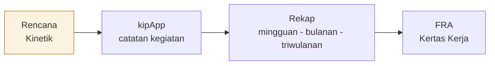
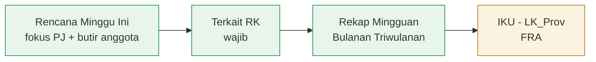

# Kinetik

Perencanaan dan pelaporan kinerja tim yang terintegrasi

Paparan untuk Pimpinan BPS Provinsi Sulawesi Tengah

<!--
Selamat pagi Bapak/Ibu pimpinan. Terima kasih atas waktunya.
Hari ini saya memaparkan Kinetik, aplikasi pelaporan kinerja tim yang kami kembangkan.
Tiga hal: apa yang sudah berjalan, bagaimana ini mendukung prioritas pimpinan di bidang perencanaan (FRA), dan apa langkah berikutnya.
Durasi sekitar 15 menit.
-->

---

# Arah paparan

<v-clicks>

1. Mengapa perencanaan perlu dibantu aplikasi
2. Apa yang **sudah berjalan** di Kinetik
3. Bagaimana Kinetik mendukung **perencanaan (FRA)**
4. Yang **direncanakan** berikutnya, risiko, dan permohonan

</v-clicks>

<!--
Saya pisahkan dengan tegas antara yang sudah berjalan dan yang masih rencana, supaya tidak ada salah paham.
-->

---

# Masalahnya

Staf sering belum tahu apa yang akan dikerjakan pada hari Senin.

Perencanaan perlu ditunjukkan dalam FRA (Kertas Kerja triwulan, lembar LK_Prov).

Aplikasi kipApp (aplikasi SKP BPS) hanya mencatat pekerjaan <b>setelah selesai</b>.

<!--
Prioritas pimpinan adalah perencanaan. Tetapi kipApp tidak dirancang untuk merencanakan: ia mencatat hasil.
Akibatnya rencana tidak punya tempat, padahal FRA meminta bukti perencanaan.
-->

---
layout: center
class: text-center
---

# Fakta dari data produksi

0
kegiatan kipApp bertanggal masa depan

8.747 / 8.759
kegiatan sudah berprogres 100

Per 5 Oktober 2026

<!--
Per 5 Oktober 2026: dari 8.759 kegiatan di kipApp, 8.747 sudah berprogres 100 persen, dan tidak ada satu pun yang bertanggal ke depan.
Artinya kipApp berisi catatan masa lalu. Rencana ke depan harus disimpan di tempat lain.
-->

---

# Gagasan Kinetik

Kinetik menyimpan **rencana sebelum pekerjaan**, lalu menautkannya ke catatan kipApp **sesudah pekerjaan**.

Tujuan akhir: pegawai tidak perlu membuka kipApp sama sekali.

<!--
Alurnya: Rencana, kipApp, Rekap, FRA.
Kotak Rencana berwarna kuning karena penyambungan otomatis ke kipApp masih rencana. Bagian rekap sudah berjalan.
Tujuan akhirnya, pegawai cukup memakai Kinetik.
-->

---

# Sudah berjalan (1): data dan rekap

Sudah Sinkronisasi kegiatan dari kipApp setiap pagi, dan tombol <b>Sinkronkan data saya</b> untuk tiap pegawai

Sudah <b>Rekap Mingguan</b> per anggota: klaim kegiatan dan bukti dukung

Sudah <b>Rekap Bulanan</b> dan <b>Triwulanan</b> disusun dari data mingguan

Sudah Ekspor ke Excel

<!--
Kegiatan ditarik dari kipApp. Setiap anggota mengklaim kegiatannya pada rekap mingguan dan melampirkan bukti.
Rekap bulanan dan triwulanan tidak diketik ulang; disusun dari data mingguan.
Semua bisa diekspor ke Excel.
-->

---

# Sudah berjalan (2): peran Penanggung Jawab tim

Sudah <b>Rekap Tim</b>: baris per kegiatan, baris sejenis digabung menjadi blok <b>Gabungan</b>

Sudah Parafrase uraian, serta <b>Permasalahan, Solusi, dan RTL</b>

Sudah Rekap dapat <b>dikunci</b> setelah ditinjau

<!--
PJ tim melihat seluruh kegiatan anggota, menggabungkan baris yang sejenis, menyederhanakan uraian, mengisi permasalahan, solusi dan rencana tindak lanjut, lalu mengunci rekap.
-->

---

# Sudah berjalan (3): perencanaan mingguan

Sudah Papan <b>Rencana Minggu Ini</b>

Sudah Fokus mingguan dari PJ

Sudah Butir rencana per anggota; setiap butir wajib terkait <b>RK</b>

Sudah Notifikasi dalam aplikasi dan peringatan token kipApp hampir kedaluwarsa

<!--
Ini bagian yang paling relevan dengan prioritas perencanaan. PJ menetapkan fokus minggu ini; anggota menyusun butir rencana. Setiap butir wajib terkait RK agar rencana bisa ditelusuri ke kinerja.
Peringatan token membantu admin mencegah sinkronisasi terhenti.
-->

---

# Sudah berjalan (4): masuk dengan akun SSO BPS

Sudah Pegawai masuk dengan <b>kata sandi akun SSO</b> masing-masing

Sudah Login pertama dengan kata sandi bawaan, lalu <b>menghubungkan</b> akun kipApp

Sudah Sinkronisasi per pengguna, memakai token pegawai sendiri bila masih berlaku

**Keamanan:** kata sandi disimpan terenkripsi dengan kunci terpisah, tidak pernah ditampilkan, berdasarkan MoU. Kinetik tidak mencoba login ulang sendiri: login hanya terjadi saat pegawai masuk.

<!--
Kata sandi disimpan terenkripsi dengan kunci tersendiri, tidak pernah ditampilkan kembali, dan dasarnya adalah MoU yang ditandatangani pegawai.
Kinetik tidak mencoba login ulang secara otomatis, dan percobaan salah dibatasi, supaya akun BPS pegawai tidak terkunci.
Pesan untuk pimpinan: ini yang memungkinkan pegawai tidak membuka kipApp.
-->

---

# Dukungan untuk prioritas FRA: perencanaan

Hijau sudah berjalan &nbsp; Kuning rencana

<!--
Hijau sudah berjalan: rencana mingguan, keterkaitan wajib ke RK, dan rekap.
Kuning masih rencana: penyajian alokasi triwulanan IKU dan ekspor format LK_Prov untuk Kertas Kerja FRA.
-->

---

# Yang direncanakan (belum berjalan)

Rencana Rencana dikirim ke kipApp pada tanggal mulai

Rencana Anggota menandai selesai dari Kinetik

Rencana Pengingat Senin 09.00 dan evaluasi Jumat sore

Rencana RTL menjadi rencana triwulan berikutnya

Rencana Alokasi triwulanan IKU dan ekspor LK_Prov

Rencana Dasbor kepatuhan perencanaan

Rencana Pembuatan SKP triwulan berikutnya dari Kinetik

<!--
Semua yang di slide ini masih rencana, belum berjalan.
Urutan pengerjaan: keterkaitan rencana ke IKU, RTL menjadi rencana, lalu format LK_Prov dan dasbor kepatuhan. Penulisan ke kipApp bergantung pada penyambungan akun seluruh pegawai.
-->

---

# Risiko dan ketergantungan

<b>kipApp</b> adalah aplikasi internal tanpa kontrak antarmuka yang dipublikasikan. Perubahan rilis dapat mengganggu sinkronisasi. <small>Mitigasi: seluruh panggilan dipusatkan di satu kelas dan diuji.</small>

<b>Kata sandi dan token</b>: kebocoran berdampak ke akun BPS. <small>Mitigasi: kunci enkripsi terpisah, tidak ditampilkan atau dicatat, tidak ada login ulang otomatis.</small>

<b>Token kipApp</b> berlaku 24 jam; bila habis, sinkronisasi berhenti. <small>Mitigasi: peringatan ke admin sebelum kedaluwarsa.</small>

<!--
Kami terbuka soal risiko. Pertama, kipApp tidak punya kontrak yang dipublikasikan, jadi bisa berubah tanpa pemberitahuan. Kedua, keamanan kata sandi. Ketiga, token berumur 24 jam.
Masing-masing sudah ada mitigasinya.
-->

---

# Langkah berikutnya dan permohonan

<v-clicks>

1. **Persetujuan** menyambungkan akun SSO seluruh pegawai ke Kinetik
2. **Percontohan** pada satu tim, lalu dievaluasi
3. Penulisan rencana ke kipApp dan pengingat mingguan (rencana)
4. Keluaran format LK_Prov untuk Kertas Kerja FRA (rencana)

</v-clicks>

<!--
Permohonan kami: pertama, persetujuan untuk membuka penyambungan akun SSO kepada seluruh pegawai. Kedua, menunjuk satu tim sebagai percontohan.
Setelah itu fitur penulisan ke kipApp dan keluaran FRA kami kerjakan bertahap.
-->

---
layout: center
class: text-center
---

# Terima kasih

Kinetik: rencana sebelum kerja, rekap sesudah kerja, bukti untuk FRA.

Pertanyaan dan masukan

<!--
Terima kasih. Kami menunggu masukan dan arahan Bapak/Ibu pimpinan.
-->
